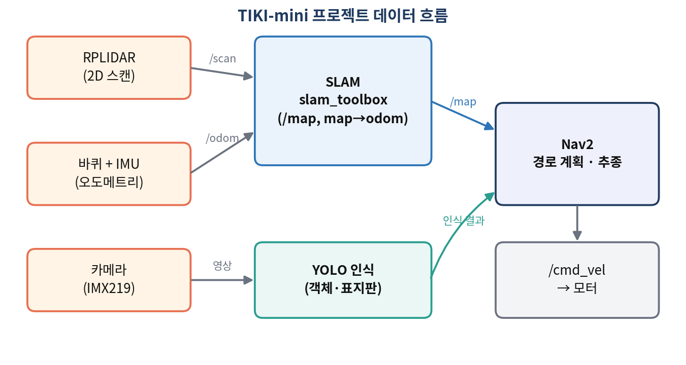
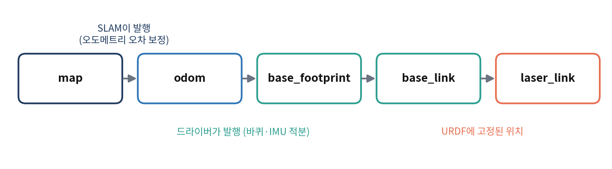
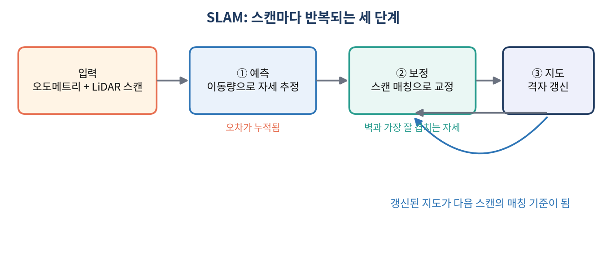

# autonomous-driving

# TIKI-mini LiDAR SLAM & 자율주행

2D LiDAR로 실내 지도를 만들고, 그 지도 위에서 목표 지점까지 스스로 주행하며 카메라 YOLO로 물체를 인식하는 모바일 로봇 프로젝트입니다.

## 목표

- [ ] LiDAR 스캔으로 2D 점유 격자 지도 작성 (SLAM)
- [ ] 작성한 지도 위에서 목표 지점까지 자율 주행
- [ ] 카메라와 YOLO로 물체·표지판 인식
- [ ] LiDAR와 카메라를 결합한 주행 시나리오

## 주요 기능

- 오도메트리 예측, 스캔 매칭, 점유 격자 갱신으로 이어지는 2D LiDAR SLAM
- 저장한 지도(`.pgm` + `.yaml`) 기반 경로 계획과 자율 주행 (Nav2)
- YOLO 기반 객체·표지판 인식
- LiDAR는 지도와 거리, 카메라는 물체 종류를 맡는 역할 분담

## 하드웨어

| 구성 | 내용 |
|---|---|
| 로봇 | TIKI-mini (차동 구동, ESP32 제어기 + CM4 컴퓨터) |
| LiDAR | RPLIDAR (2D, 바닥에서 약 13.4 cm 높이 단면) |
| 카메라 | IMX219 |
| IMU | BNO055 (9축) |

## 시스템 구성

주요 토픽과 TF

| 항목 | 내용 |
|---|---|
| 입력 | `/scan` (LiDAR), `/odom` (바퀴 명령 + IMU) |
| 출력 | `/map` (점유 격자 지도), TF `map → odom` |
| 제어 | `/cmd_vel` |

`odom → base_footprint`는 드라이버가 오도메트리로, `map → odom`은 SLAM이 발행하며 오도메트리가 쌓은 오차를 보정합니다.

## SLAM 동작 원리

1. **예측**: 이동 거리와 회전량으로 새 자세를 계산합니다. 오차가 누적됩니다.
2. **보정**: 예측 주변 후보 자세 중 지도의 벽과 가장 잘 겹치는 자세를 고릅니다.
3. **지도 갱신**: 빔이 지나간 칸은 비어 있음, 끝난 칸은 벽 쪽으로 점수를 갱신합니다.

## 구현 단계

1. **로봇 제어·오도메트리**: 모터 제어와 IMU heading으로 이동량 추정
2. **LiDAR 데이터 처리**: 스캔 읽기, 각도·거리 규약 변환, 유효값 필터링
3. **SLAM 지도 작성**: 스캔 매칭과 점유 격자 갱신으로 지도 생성, `.pgm`/`.yaml` 저장
4. **카메라 + YOLO 인식**: 카메라 영상에서 물체·표지판 검출
5. **Nav2 자율 주행**: 저장한 지도로 위치 추정과 경로 계획, 목표 지점 주행
6. **LiDAR + 카메라 통합**: 지도·거리는 LiDAR, 물체 인식은 카메라가 담당하는 시나리오

## 참고

- TIKI-mini 인터랙티브 강의: https://irodmas.com/studytiki/
